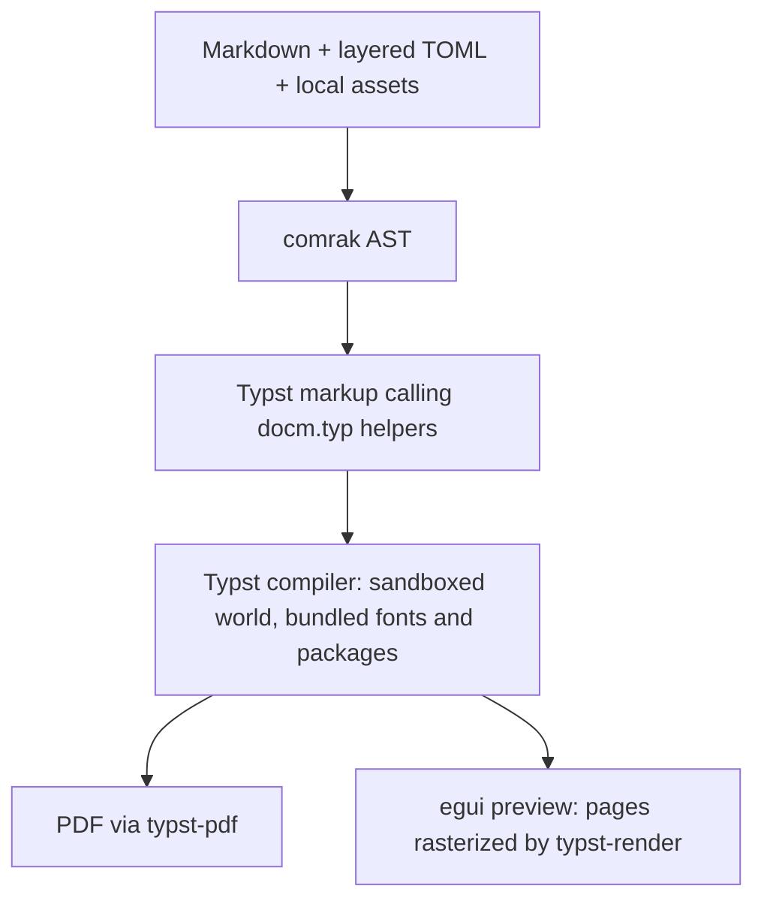

# docm: implementation overview

docm renders Markdown (with LaTeX math and diagrams) to PDF, offline, on macOS arm64 and Linux x64. It is one Rust binary ([`crates/docm`](crates/docm)) that typesets through Typst. It has no browser, Node, or network access, and the preview shows the same Typst document the export writes. A release build renders a typical document in about 0.2 s.



## Command line

`docm notes.md` opens a preview window owned by that terminal invocation; separate invocations are independent. `docm r notes.md [-o report.pdf]` renders without a window and needs no display server. The default output is the source path with `.pdf`. `-o -` reserves stdout for PDF bytes, and diagnostics go to stderr. `--config FILE` adds a theme layer. clap parses the arguments; `docm -- r` previews a file literally named `r`.

Exit codes are 0 for success (warnings included), 1 for rendering/configuration/I/O failure, and 2 for invalid arguments. Ctrl-C terminates the process (shells report 130). docm is a CLI that opens a window: it has no `.app` bundle and no Finder or desktop launch integration.

## Pipeline

- **[`config.rs`](crates/docm/src/config.rs):** layered TOML (see [Configuration model](#configuration-model)).
- **[`markdown.rs`](crates/docm/src/markdown.rs):** comrak parses CommonMark + GFM (tables, task lists, strikethrough, footnotes, autolinks) and `$`/`$$` math. A pre-pass rewrites formatting-macro tags and `:::pagebreak` outside code and math: a standalone tag line becomes a private HTML comment block, and an inline tag becomes a private-use sentinel. Line numbers are preserved. The tree is emitted as calls into the helper library. **All text is escaped** (every ASCII punctuation character), so Typst syntax only runs inside ` ```typst ` blocks and diagram fences.
- **[`docm.typ`](crates/docm/src/docm.typ):** the Typst helper library (`docm-par`, `docm-heading`, `docm-table`, `fit`, …). [`template.rs`](crates/docm/src/template.rs) generates `/config.typ` (the resolved theme as a dictionary) and the preamble with headers and footers.
- **[`world.rs`](crates/docm/src/world.rs):** the Typst `World`. It serves only the generated sources, assets docm read and validated (images, logos, code themes), and the vendored package tree compiled into the binary. Typst code cannot read other files (`read("/etc/passwd")` fails) or download packages.
- **[`render.rs`](crates/docm/src/render.rs):** compiles, exports the PDF, and maps Typst diagnostics back to Markdown lines through a source map recorded during emission. Fence bodies map line-for-line. Errors raised inside a package with no document span are attributed to the fence that imports that exact `name:version`.
- **[`preview.rs`](crates/docm/src/preview.rs):** the eframe/egui window (see [Live preview and safe export](#live-preview-and-safe-export)).
- **[`output.rs`](crates/docm/src/output.rs):** safe PDF writes.

### Mapping Markdown to Typst

| Markdown | Typst |
|---|---|
| Headings | Real `heading` elements with GitHub-style slug labels, so `[x](#slug)` links, the contents block and PDF bookmarks work. `number_headings` uses `1.1` numbering. |
| `$…$`, `$$…$$`, ` ```math ` | LaTeX converted by the vendored **mitex** package (`mi`/`mimath`). `[math.macros]` (`args` 0–9 and a TeX `body`) become `\newcommand` definitions prepended to each expression. The math font is New Computer Modern Math. |
| Footnotes | Native Typst footnotes at the bottom of the page; repeated references reuse the first. |
| Code fences | `raw` blocks with Typst's syntax highlighting. Long lines wrap. |
| Images | Local PNG/JPEG/GIF/WebP/SVG (sniffed by content). Paths are percent-decoded and relative to the Markdown file. Images shrink to fit the printable area without distortion. URLs are rejected. |
| Raw HTML | Shown literally, never interpreted. |
| Links | `http`, `https`, `mailto` and relative targets are kept. Other schemes, and fragments with no matching heading, keep only their text. |
| `:::pagebreak` (own line) | A weak page break before the next block. Leading, trailing and repeated breaks never create empty pages. It is an error inside lists, quotes, tables, footnotes or layout macros, because Typst cannot break pages inside containers. |

## Diagrams

A fence named after a package renders a diagram. Its body is the ordinary input to that package's main function; docm adds the import and the call:

| Fence | Package | Body | Use for |
|---|---|---|---|
| ` ```diagraph ` | diagraph 0.3.8 (Graphviz as WASM) | DOT (passed as a string) | Automatically laid out flowcharts, state, class and ER diagrams |
| ` ```fletcher ` | fletcher 0.5.8 | `node(...)`, `edge(...)` arguments | Hand-placed diagrams |
| ` ```chronos ` | chronos 0.3.0 | `_par`, `_seq`, … | Sequence diagrams |
| ` ```timeliney ` | timeliney 0.4.0 | `headerline`, `taskgroup`, `task`, … | Gantt charts and timelines |
| ` ```cetz ` | cetz 0.5.3 | cetz draw calls | Free drawing |
| ` ```cetz-plot ` | cetz-plot 0.1.4 (with cetz 0.5.2) | `plot.plot(...)`, `chart.piechart(...)`, … | Plots, pie and bar charts |

Fences are ordinary theme configuration ([`defaults.toml`](defaults.toml) defines the built-ins), and themes can add their own:

```toml
[diagram.packages.chronos]
imports = ["@preview/chronos:0.3.0"]
wrap = """
chronos.diagram({
import chronos: *
{{body}}
})"""
```

`{{body}}` inserts the fence contents as Typst code, and `{{body_string}}` inserts them as a string literal. Imports must be bundled. `[diagram]` styles every diagram, and `[diagram.charts.N]` overrides the N-th diagram fence, inheriting the final `[diagram]` settings. Artwork shrinks to fit the printable area. `width`/`height` fit it into that box without distortion and may enlarge it. Raw Typst is only accepted inside ` ```typst ` blocks.

[`scripts/vendor-typst-packages.sh`](scripts/vendor-typst-packages.sh) downloads the pinned packages and everything they import into `crates/docm/packages/` (licenses included). [`scripts/vendor-fonts.sh`](scripts/vendor-fonts.sh) fetches Source Sans 3 and Source Code Pro (OFL) into `crates/docm/fonts/`. Both trees are embedded with `include_dir`.

## Configuration model

Layers merge recursively in this order: built-in [`defaults.toml`](defaults.toml) → global theme → invocation-directory `theme.toml` → `--config` → document frontmatter. Tables merge; scalars and arrays replace.

- **Global theme:** `~/Library/Application Support/docm/theme.toml` on macOS. On Linux it is `$XDG_CONFIG_HOME/docm/theme.toml`, falling back to `~/.config/docm/theme.toml` when `XDG_CONFIG_HOME` is unset, empty, or relative.
- **Frontmatter:** opening and closing `+++` lines at the start of the document. Its lines still count toward Markdown error locations.
- Automatic files are optional; explicit configs must exist. Discovery does not walk parent directories or search beside the document.
- Font and logo paths belong to the file that declares them.

Every layer is strictly deserialized before merging (`deny_unknown_fields`, typed lengths and colors), including values a later layer overrides, so errors carry the TOML line. Unknown keys, bad units or colors, undeclared font aliases, and margins that leave no printable area are errors. Element typography inherits from the final `[body]`; box settings (spacing, padding, background, border) do not. Empty decoration slots, `enabled = false`, and `logo = false` suppress inherited values. Lengths accept `px` (96 per inch), `pt`, `mm`, `cm` and `in`.

[`defaults.toml`](defaults.toml) is the runtime base layer and the reference for every option. Copy it to `theme.toml`, or pass it with `--config`. Defaults include A4 portrait, 20 mm margins, Source Sans 3 prose, Source Code Pro code, and New Computer Modern math. Each heading block, `[headings.h1]` through `[headings.h6]`, supports `text_align` values `left`, `center`, `right` and `justify`.

- **`[fonts]`** maps aliases to local `.ttf`, `.otf` or `.ttc` files (Typst cannot read WOFF). `sans` and `mono` are built in.
- **`code.theme`** is `"default"` (Typst's highlighting), `"none"`, or a path to a `.tmTheme` file.
- **Headers and footers** have left/center/right slots with wrapping text and an aspect-preserving logo. Tokens are `{{filename}}`, `{{title}}` (the first level-one heading, or the file stem), `{{page}}` and `{{pages}}`; quadruple braces escape literal double braces. A decoration taller than its margin space is an error naming the margin to increase; it is never clipped.

Themes from docm 0.1 (Electron) are not migrated. `[mermaid]`, `code.wrap`, Shiki theme names and WOFF fonts are errors.

### Formatting macros

`<left>...</left>`, `<right>...</right>`, and `<center>...</center>` are available by default. They are ordinary definitions under `[macro.left]`, `[macro.right]` and `[macro.center]`; any layer can redefine them or add more:

```toml
[macro.mymacro]
text_align = "center"
```

```markdown
<mymacro>
# Centered heading

This **paragraph**, and other blocks inside the tags, are centered.

<right>
This paragraph is right-aligned instead.
</right>
</mymacro>
```

Macros support `text_align` (`left`, `center`, `right`), `float` (`left`, `right`, `none`), and positive `width` / `height` lengths. A merged definition needs at least one setting. A macro's alignment overrides body, element and table-column alignment for its contents, including images, display math and diagrams. The innermost alignment wins. Alignment-only macros are plain scopes, so page breaks still work inside them; `width`/`height` macros are boxes. Content taller than an explicit `height` is an error, not clipped.

`float = "left"|"right"` places the macro beside the blocks that follow it, up to the next heading, rule, page break or float, as two columns with a 12 pt gap. Text sits beside the float but does not flow underneath it. Put the prose **after** the closing tag.

Names are case-sensitive ASCII letters followed by letters, digits, `_` or `-`. Only exact bare `<name>` / `</name>` tags are recognized. Put tags on their own lines for multi-block content; `<mymacro>short text</mymacro>` also works, and its content gets its own aligned block. A heading can be wrapped as a whole (`# <center>Title</center>`). Tags nest but must close in order within the same Markdown container; unclosed or mismatched tags are source-located errors. Code and math contents, escaped tags (`\<center>`), and unconfigured HTML stay literal.

## Live preview and safe export

A worker thread renders, and a `notify` watcher on each dependency's directory triggers re-renders, debounced by 250 ms and coalesced. The watch set covers the source, themes (including missing optional ones), images, fonts and logos, so a broken document recovers once fixed. A result is published only if its SHA-256 input snapshot still matches the disk; filesystem notifications alone do not establish freshness.

The window keeps the last good pages while a replacement renders or fails, under a red error banner. Pages are rasterized lazily, only those visible, at the current zoom (fit width, or ⌘+ / ⌘− / ⌘0). The preview has no text selection or clickable links; the exported PDF has both.

**Export** (button or ⌘S) saves the displayed render's PDF bytes, not a re-render. It refuses while the current input has errors or has changed since that render. [`output.rs`](crates/docm/src/output.rs) rejects destinations that are, resolve to, or hard-link an input or dependency. It writes an exclusively created temporary file beside the destination, syncs it, rechecks the snapshot, and renames it into place. A failure or veto leaves the existing destination untouched. `docm r` uses the same writer.

### Warnings

Non-fatal problems are located like errors and never fail a render. `docm r` prints them to stderr as `docm: warning: FILE:LINE:COL: …`. The preview shows them in a dismissible yellow banner, which returns only when the set of warnings changes. Sources: docm's own checks (a leftover ` ```mermaid ` fence, which renders as code) and Typst's compiler warnings (for example, an unknown font family in a ` ```typst ` block).

## Development

| Command | Purpose |
|---|---|
| `cargo run -- notes.md` | Preview |
| `cargo run -- r notes.md [-o out.pdf\|-]` | Headless render |
| `cargo test` | Config, converter, rendering, error location and CLI tests |
| `cargo run --example pages -- notes.md /tmp/page` | Write each page as a PNG (for inspecting output) |
| `cargo run --example typst -- in.typ out.pdf` | Compile raw Typst in docm's sandboxed world |
| `cargo dist` | Build this host's release artifacts into `dist/` |
| `cargo bump …`, `cargo tag-release` | Release helpers (see [CI and releases](#ci-and-releases)) |

- **Toolchain:** pinned in [`rust-toolchain.toml`](rust-toolchain.toml).
- **Debug builds:** dependencies are optimized even here, because Typst's WASM plugin runtime (mitex, Graphviz) is very slow unoptimized.
- **Packaging scripts:** they need `python3`; the binary does not.

## Packaging and releases

[`scripts/package.sh`](scripts/package.sh) builds the host's artifacts into `dist/`. Cross-compilation is not supported.

| Host | Files |
|---|---|
| macOS arm64 | `docm-VERSION-darwin-arm64.tar.gz` |
| Linux x64 | `docm-VERSION-linux-x64.tar.gz`, `.deb`, `.rpm` (building the `.rpm` needs `rpmbuild`) |

Each archive holds `docm-VERSION/bin/docm` and `share/doc/docm/` (`defaults.toml`, `copyright`, and `third-party/`). [`scripts/notices.py`](scripts/notices.py) collects the license files and declared licenses of every runtime crate (from `cargo tree -e normal`), vendored Typst package, and bundled font. The macOS binary carries the linker's ad-hoc signature, which Homebrew leaves intact. It is not notarized.

The Linux binary links only libc, libm and libgcc_s. The preview loads its windowing libraries (EGL/GL, Wayland, X11, xkbcommon) at runtime. So the `.deb` and `.rpm` require only glibc and *recommend* the GUI libraries, which lets headless servers install docm without a desktop stack. The `.deb`'s glibc minimum is read from the binary's symbol versions; rpmbuild generates the `.rpm`'s. Both install `/usr/bin/docm`.

- **Homebrew formula:** [`scripts/formula.py`](scripts/formula.py)` DIR [--release OWNER/REPO]` prints it. It has `on_macos`/`on_linux` blocks for the prebuilt archives and runs `bin.install "bin/docm"`.
- **Install checks:** [`scripts/brew-check.sh`](scripts/brew-check.sh) installs the formula through a throwaway tap and runs `brew test`. [`scripts/package-check.sh`](scripts/package-check.sh) installs the `.deb` on the runner and the `.rpm` in Fedora and openSUSE containers.
- **Smoke test:** after installing, each check runs [`scripts/smoke-installed.sh`](scripts/smoke-installed.sh), which checks the version and does a display-less render with math and a Graphviz diagram.
- The check scripts refuse to run outside GitHub Actions.

### Distribution

| Platform | Install |
|---|---|
| macOS arm64, Linux x64 (Homebrew) | `brew tap john-marinelli/docm https://github.com/john-marinelli/docm.git` then `brew install --formula john-marinelli/docm/docm` |
| Debian / Ubuntu | `sudo apt install ./docm-VERSION-linux-x64.deb` |
| Fedora / RHEL | `sudo dnf install ./docm-VERSION-linux-x64.rpm` |
| openSUSE | `sudo zypper install --allow-unsigned-rpm ./docm-VERSION-linux-x64.rpm` |

Linux targets x86_64 glibc distributions; ARM64 and musl (Alpine) are unsupported. The preview needs a desktop with EGL/GL and X11 or Wayland. Rendering needs nothing beyond glibc.

### CI and releases

Everything lives in `john-marinelli/docm`: source, workflows, GitHub Release assets, and the tap's `Formula/docm.rb`.

- [CI](.github/workflows/ci.yml) runs on macOS arm64 and Ubuntu 24.04 x64. On both it checks formatting, runs clippy (`-D warnings`) and the tests, packages, installs through Homebrew, and renders without a display. On Linux it also installs the `.deb` on the runner and the `.rpm` on current Fedora and openSUSE Tumbleweed.
- [Release](.github/workflows/release.yml) runs for a pushed `vX.Y.Z` tag. The tag must equal `v` + the Cargo version ([`scripts/version.sh`](scripts/version.sh)) and be on `main`. Each platform repeats the tests and package checks on the tagged commit. A publish job then uploads every archive and package, with `SHA256SUMS`, to a new GitHub release. It renders the formula with release URLs and opens a **Homebrew: docm X.Y.Z** PR. The tap changes only when that PR is merged. Re-running publish for an existing release fails rather than overwriting it.

One-time setup: the repository and its releases must be public, and **Settings → Actions → General → Workflow permissions → Allow GitHub Actions to create and approve pull requests** must be enabled. PRs opened with `GITHUB_TOKEN` do not trigger CI on their own; the formula PR is checked by the release run that produced it.

Releases use the cargo aliases in [`.cargo/config.toml`](.cargo/config.toml), implemented by the dependency-free [`xtask`](crates/xtask/src/main.rs) crate:

```sh
cargo bump patch        # or minor / major / X.Y.Z: sets [workspace.package] version, updates Cargo.lock, commits "chore: release X.Y.Z"
git push                # then wait for CI on main
cargo tag-release       # creates and pushes the annotated vX.Y.Z tag, which starts the release workflow
```

Both commands require a clean `main` that matches `origin/main`. They refuse if the version's tag already exists, and `bump` refuses a version that isn't newer. `cargo dist` runs [`scripts/package.sh`](scripts/package.sh), and `cargo xtask version` prints the version. Only `v`-prefixed tags start the release workflow.

When the workflow finishes, review and merge the formula PR. If published assets are wrong, fix the code and cut a new patch release; published releases are never replaced.
