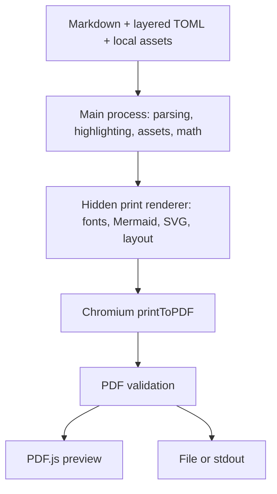

# docm: implementation overview

docm is an offline Markdown-to-PDF application for macOS arm64. Its central decision is **PDF-first preview**: the window displays generated PDF bytes, not a separate HTML approximation. Electron supplies Chromium's layout/printing engine and desktop integration; the tradeoff is a bundled browser runtime and a large application for a small feature set.

## Architecture



[`src/main/index.ts`](src/main/index.ts) coordinates preview, one-shot rendering, native dialogs, and shutdown. `docm notes.md` owns a terminal-attached window; separate invocations are independent. `docm r notes.md [-o report.pdf]` renders once without opening a preview. `-o -` reserves stdout for PDF bytes; diagnostics go to stderr. Finder launch opens a Markdown picker and uses the selected document's directory for theme discovery.

The shell [launcher](bin/docm) resolves its symlinks and `exec`s the bundled app, preserving the invocation directory, arguments, signals, and exit status without needing developer Node on PATH. Commander handles CLI parsing. Exit codes are 0 for success, 1 for rendering/configuration/I/O failure, 2 for invalid arguments, and 130 for Ctrl-C.

## Content preparation

[`src/render/markdown.ts`](src/render/markdown.ts) uses unified/remark to parse CommonMark, GFM tables/tasks/footnotes, and math into an AST, then rehype to serialize generated HTML. AST processing preserves source positions and separates syntax from literal code.

- **Code and structure:** Shiki highlights bundled languages; unknown languages remain escaped, unhighlighted code. Unique heading IDs support links, optional numbering, and a linked contents block. A custom standalone `:::pagebreak` construct respects code/math literals and avoids empty pages from leading/trailing/repeated breaks.
- **Authored HTML and links:** raw HTML is escaped rather than executed; arbitrary document CSS is not exposed. HTTP(S)/mailto links remain links without fetching their targets. Unsupported link schemes lose their target.
- **Local assets:** [`assets.ts`](src/render/assets.ts) reads, validates, and embeds PNG/JPEG/WebP/GIF/SVG images and font files. Image paths belong to the Markdown file; font/logo paths belong to the configuration file declaring them. Remote image URLs are rejected.

### Math and Mermaid

**MathJax replaces a native TeX toolchain.** [`math.ts`](src/render/math.ts) converts mathematical TeX to vector SVG in the main process. MathJax 4.1.3 and all New Computer Modern glyph ranges are bundled: no CDN, native TeX installation, subprocess, or host-font fallback. `$...$` is inline math; standalone `$$` lines delimit display math. SVG baseline measurements preserve inline alignment.

The enabled packages are `base`, `ams`, `mathtools`, `newcommand`, `textmacros`, `boldsymbol`, and `color`. TOML macros specify `args` (0–9) and a TeX `body`, but cannot replace built-ins. Fresh parser state isolates each expression; input is capped at 64 KiB, with bounded expansion and caching. Invalid commands, unsupported glyphs, and malformed expressions produce diagnostics rather than placeholders. Full LaTeX documents, arbitrary packages, file input, shell execution, and `\require` are unsupported; the math font is fixed.

**Mermaid runs in the print renderer**, where fonts and DOM measurements are available. [`mermaid.ts`](src/render/mermaid.ts) recognizes fences labeled exactly `mermaid`, enables strict security, disables HTML labels, and rejects inline configuration directives/frontmatter. TOML is the single configuration path. `[mermaid.charts.N]` overrides diagrams by one-based Mermaid-only order. One dimension scales proportionally; two define a bounding box. Natural-size diagrams only shrink to fit; explicit sizes may enlarge them, within the printable area.

The shared [SVG sanitizer](src/renderer/print/sanitize-svg.ts) checks image/diagram/math SVG before insertion, rejecting active content and external references. Inserted math/diagram IDs are namespaced to avoid collisions.

## Page layout and printing

[`src/render/pdf.ts`](src/render/pdf.ts) serializes print jobs and creates an isolated hidden window for each, with cancellation and a 60-second timeout. The [print renderer](src/renderer/print/main.ts) loads fonts, decodes images, renders diagrams, inserts math, and waits for layout readiness before printing.

- **One pagination engine:** generated CSS `@page` owns physical dimensions, orientation, margins, and repeated decorations. `printToPDF` uses CSS page sizing, backgrounds, zero API margins, and no built-in header/footer templates. Page-margin boxes require Chromium 131+.
- **Fit without stretching:** images and diagrams fit the printable area. Blocks that fit a page are kept together; oversized tables/code/quotes remain splittable.
- **Measured decorations:** [headers/footers](src/renderer/print/page-decoration.ts) have left/center/right slots, wrapping text, and aspect-preserving logos. Tokens are `{{filename}}`, `{{title}}`, `{{page}}`, and `{{pages}}`; quadruple braces escape literal double braces. Overflow reports a required margin adjustment instead of clipping or silently shrinking.
- **Post-print validation:** PDF.js parses the generated bytes and supplies the real page count for another decoration-overflow check. Tagged output and outlines are requested, but PDF/UA compliance is not promised. Prose/code are selectable; vector math is not guaranteed to be copyable/searchable.

## Configuration model

[`src/config/load.ts`](src/config/load.ts) recursively merges defaults → `~/Library/Application Support/docm/theme.toml` → invocation-directory `theme.toml` → `--config` → document TOML frontmatter. Frontmatter uses opening/closing `+++` lines at the start of the document. Automatic files are optional; explicit configs must exist. CLI discovery does not walk parent directories or implicitly search beside the document.

Strict Zod [schemas](src/config/schema.ts) validate every layer before merging, including values later overridden. Unknown keys, invalid units/colors/font aliases, and margins that leave no printable area are errors. Element typography inherits from the final body style; box spacing does not. Chart overrides inherit final global Mermaid settings. Empty decoration slots, `enabled = false`, and `logo = false` explicitly suppress inherited values.

[`src/config/defaults.ts`](src/config/defaults.ts) is the runtime source of defaults; [`defaults.toml`](defaults.toml) is an editable reference, not automatically loaded. Use `--config defaults.toml` or copy it to `theme.toml`. Defaults include A4 portrait, 20 mm margins, Source Sans 3 prose, Source Code Pro code, and New Computer Modern math. Consult the schema for all supported options.

## Live updates and safe export

[`PreviewSession`](src/main/session.ts) owns Chokidar watchers, dependencies, revisions, cancellation, and export. Changes are debounced by 250 ms; newer revisions abort obsolete work. The watch set includes source, themes, images, fonts, logos, and missing dependency paths needed for recovery. Results carry SHA-256 dependency snapshots and are published only while their revision and snapshot remain current: filesystem notifications alone do not establish freshness.

The [preview](src/renderer/preview/main.ts) retains the last good PDF while replacements render or fail, showing a stale/error diagnostic rather than blanking the document. [PDF.js integration](src/renderer/preview/pdf-preview.ts) supplies continuous pages, text/link layers, zoom/fit controls, lazy rendering with bounded page buffering, and approximate reading-position restoration. Superseded document loads are cancelled and released. PDF.js is pinned to 5.4.394 and configured with `isEvalSupported: false`; the viewer accepts generated bytes, not arbitrary imported PDFs.

**Export saves the latest successful displayed revision**, not a screenshot or a differently configured re-render. After the native dialog, it waits for current rendering, checks dependencies, and rechecks snapshot/revision before committing. Changed inputs trigger fresh work; invalid current input refuses stale export. Cancellation writes nothing.

[`output.ts`](src/main/output.ts) rejects destinations aliasing source/config/assets, including resolved symlinks and existing hard links. Output goes to an exclusively created same-directory temporary file, which is synced/closed and renamed into place. Precommit failures preserve the existing destination and clean up the temporary file. This is atomic replacement, not a filesystem lock against other processes.

## Process boundaries

The main process owns filesystem access, dialogs, and writes. Both renderers disable Node integration and enable context isolation, sandboxing, and web security. Narrow [preload bridges](src/preload) expose only required operations; main-process IPC checks the sending window and main frame, with an additional URL check for preview requests.

The [`docm:` protocol](src/main/protocol.ts) serves allowlisted bundled resources, applies resource policies, denies permissions, and blocks navigation, popups, and webviews. Print documents block network connections; approved external links open through the system, not inside the app. Bundled fonts/viewer resources and embedded assets allow offline rendering. Shutdown aborts work, closes print windows, stops watchers, and releases resources.

## Build, distribution, and verification

TypeScript builds through electron-vite: ESM main process, CommonJS preloads, separate preview/print bundles. electron-builder assembles the arm64 app, bundled runtime, assets, and third-party notices. [`mise.toml`](mise.toml) remains the single authority for exact Node/pnpm versions and exposes every project task. Mise is a developer entry point, not a build dependency: preparation and source builds read its quoted `[tools]` version entries directly without executing mise or requiring its configuration/data directories.

With the pinned Node/pnpm versions available, `pnpm run build` compiles the application and `pnpm run package` compiles, prepares notices, and assembles `dist/mac-arm64/Docm.app` in order. The corresponding mise tasks delegate to these same scripts. The frozen-source build additionally checks types, installs locked dependencies offline, and stages the supplied Electron runtime; it invokes only Node/pnpm and macOS system tools, never mise. Tool discovery validates the running Node and an actual installed pnpm executable on PATH; it does not install tools or depend on manager shims.

Electron 44 has no package `postinstall` hook: `pnpm install` installs its JavaScript package but does not download `electron/dist`. After a fresh dependency installation, run `mise run bootstrap:electron` (or `pnpm run bootstrap:electron`) before development, packaging, or release preparation. The composite CI setup opts into this explicit runtime bootstrap through `electron: "true"` in CI and release-build jobs; publication, public-install verification, and formula-PR jobs do not bootstrap an unnecessary checkout runtime.

| Tasks | Purpose |
|---|---|
| `mise run dev` | Development application |
| `mise run build`, `mise run typecheck`, `mise run test` | Compile, check types, run Vitest |
| `mise run smoke` | Build and exercise the Electron CLI/preview |
| `mise run build:smoke` | Build fresh source without mise on PATH, then exercise the packaged CLI |
| `mise run package`, `mise run package:smoke` | Assemble `dist/mac-arm64/Docm.app`, exercise the bundle |
| `mise run formula:prepare`, `mise run formula:install` | Prepare private Homebrew inputs, source-build/install |
| `mise run formula:refresh`, `mise run formula:smoke` | Rebuild after changes, exercise installed app |

The private `docm/local` formula builds TypeScript in a clean staged tree from checksummed source, a frozen offline pnpm store, and an existing Electron archive—not checkout outputs or an old app. It stages official Node and pnpm build resources at the exact versions selected by `mise.toml`, then runs `pnpm run formula:build`; no preinstalled mise or personal tool directory is required. Preparation obtains Node's archive checksum from its release checksum list and validates the pnpm registry archive's SHA-512 integrity before recording its SHA-256. Homebrew fetches the resources before the network-denied build. **Electron/Chromium remains prebuilt upstream; “source-built” applies to docm.** Installation uses Cellar `libexec` plus a CLI symlink, not `/Applications`. Source/store/Electron `file://` inputs still make this checkout-specific, not a public Homebrew release.

[Distribution scripts](scripts/homebrew.mjs) verify ownership/provenance before replacing installations and refuse unrelated or modified products. Local maintenance commands do not install/upgrade global tooling; preparation needs the exact Node/pnpm versions already available. Existing installations change only through explicit refresh, not ordinary preparation. Signing is ad-hoc, without Developer ID or notarization; Gatekeeper, quarantine, and sandbox protections are not bypassed.

The pinned pnpm 12 resource is the official `@pnpm/exe.darwin-arm64` archive, whose executable is `pnpm` at the package root. It is not the generic `pnpm` wrapper archive and does not contain the older `bin/pnpm.cjs` entrypoint. The formula puts that native executable's directory on PATH without running package installation hooks.

[`scripts/smoke.mjs`](scripts/smoke.mjs) exercises PDF contents, themes/assets, watch recovery, reading controls, export consistency, Ctrl-C, and repeated 200-page updates. Screenshots/reports go under `.build/smoke`, `.build/package-smoke`, or `.build/formula-smoke`. Export smoke controls the native dialog response while exercising real IPC, freshness checks, and writes; native Save-panel interaction remains unautomated. Installed desktop behavior uses `formula:smoke`, not a disabled Homebrew test sandbox.

[`scripts/build-smoke.mjs`](scripts/build-smoke.mjs) stages a fresh source tree and frozen dependencies, reuses the pinned Node, and downloads/stages the exact checksummed pnpm resource used by the formula. It verifies the resource's package identity and executable version, then uses that executable for the complete source build with mise absent from PATH and a fresh HOME. It checks the app signature and verifies version/PDF text through the packaged CLI with no developer tools on its runtime PATH. Evidence is written under `.build/build-smoke`; staged pnpm is temporary, and no global tooling or installed Homebrew package is changed.

Frozen-source packaging removes inherited `CSC_*`/`APPLE_*` variables, disables signing-identity discovery, and explicitly forces ad-hoc signing (`mac.identity=-`) with notarization off. Only that packaging subprocess sets `CSC_FOR_PULL_REQUEST=true`; no workflow-wide override or Apple signing credentials are needed. This allows the modified Electron bundle to be re-signed on PR builds. The smoke supplies `GITHUB_BASE_REF` when absent so local/main runs exercise the same PR signing guard and strict signature check. electron-builder still emits its generic PR-signing security warning.

## Releases and public Homebrew distribution

Everything lives in `john-marinelli/docm`: source, Actions workflows, GitHub Release assets, and the public tap's `Formula/docm.rb`. The application version comes from `package.json`; `scripts/version.mjs` supplies explicit stable SemVer bumps and tag checks, and the CLI bundles that same version. Tool versions still come from `mise.toml`. Version commands never commit, tag, or push automatically.

### Workflows

- [CI](.github/workflows/ci.yml) runs typecheck, behavior tests, and a clean-source build/packaged-CLI smoke on pull requests and `main` pushes. It also supports manual dispatch, which the release bot uses for its formula PR. Setup uses pinned Actions and a pinned mise bootstrap; the actual source build excludes mise.
- [Release](.github/workflows/release.yml) runs only when a `vX.Y.Z` tag is pushed. It checks the tag/package version, resolves annotated or lightweight tags to the source commit, requires source history from `main` and an unchanged tracked checkout, then builds and exercises the exact candidate assets. Before publication, it also installs the formula through Homebrew using those same local source/store/Electron archives and the real official tool resources. Repository-wide release concurrency is serialized with pending runs queued rather than replaced.
- Publication uploads all verified files into a draft before making it public. A fresh runner then verifies unauthenticated downloads, installs the candidate formula under Homebrew's normal sandbox, exercises the installed CLI outside `brew test`, and uninstalls it. Only successful public-install verification permits a PR updating `Formula/docm.rb`; the workflow never pushes that update directly to `main` or merges it.

Release assets are `docm-VERSION-source.tar.gz`, `docm-VERSION-pnpm-store.tar.gz`, `docm-VERSION-electron-darwin-arm64.tar.gz`, `release-manifest.json`, `docm.rb`, and `SHA256SUMS`. The portable manifest records source commit, version, target architecture, tool versions, and resource hashes without checkout/cache paths. The candidate formula uses GitHub Release HTTPS URLs and official pinned Node/pnpm resources. `scripts/formula.mjs` renders both public and private recipes; publication does not invoke the private local-installation manager. No prebuilt app ZIP, Homebrew bottle, Apple signing credentials, or cask is part of this workflow.

### One-time repository setup

Commit/review/push this implementation to `main` before creating a release tag. Enable Actions and **Settings → Actions → General → Workflow permissions → Allow GitHub Actions to create and approve pull requests**. The jobs request only their required contents/PR/dispatch permissions and use the automatic `GITHUB_TOKEN`, not a personal token. Organization policies may require an administrator to permit these operations. GitHub can ask for approval of bot-created PR workflows; the publisher also explicitly dispatches CI for the formula branch.

The repository and release downloads must be public for unauthenticated Homebrew installs. Keep branch protections/reviews in place, and restrict who may create or move release tags. The first formula file is created by the first successful release PR, not a placeholder pointing to nonexistent assets.

### First release example: 0.1.0

For an initial release whose package version is `0.1.0`, tag the tested commit on `main` without bumping it again. This is an example, not a tag to reuse after it already exists:

```sh
git switch main
git pull --ff-only
mise run release:check -- v0.1.0
git tag v0.1.0
git push origin v0.1.0
```

Watch the **Release** workflow in GitHub Actions. When all release jobs pass, review and merge the generated **Homebrew: docm 0.1.0** PR. That merge makes the formula available from this repository's default branch.

### Subsequent releases

Choose `patch`, `minor`, or `major`. For example, after `0.1.0`:

```sh
git switch main
git pull --ff-only
mise run release:version -- patch
git add package.json
git commit -m "chore: release 0.1.1"
git push origin main
```

After CI passes, tag the exact version printed by the bump command:

```sh
mise run release:check -- v0.1.1
git tag v0.1.1
git push origin v0.1.1
```

Patch increments the last component; minor increments the middle and resets patch; major increments the first and resets both lower components. Tags must exactly match `package.json`; prereleases and build-metadata versions are not accepted. Repeat the workflow review and formula-PR merge for each release.

### Installation, evidence, and failures

After the formula PR is merged:

```sh
brew tap john-marinelli/docm https://github.com/john-marinelli/docm.git
brew install --formula john-marinelli/docm/docm
```

The public formula does not require preinstalled mise, Node, or pnpm. Existing private/local docm installations are not silently replaced; the disposable CI installation check refuses a preexisting docm installation.

`release:prepare` creates `.build/release` (or an explicit fresh `--output` directory); `release:smoke -- --directory DIR` rebuilds and exercises those exact files with the actual pnpm resource. `release:homebrew` is restricted to disposable Actions runners because it installs/uninstalls a real formula. Its `--local-assets` mode tests candidate archives before publication; the default mode tests the public download URLs afterward. Both modes use the shared formula renderer and identical checksums. Evidence lives in `.build/release-smoke` and `.build/release-homebrew` and is retained as workflow artifacts. CLI/PDF checks do not claim native preview or Save-panel interaction coverage.

Published releases/assets are never overwritten. A failed upload leaves a draft to inspect; remove only that failed draft before rerunning its failed publication job. If a publication response could not be confirmed, inspect the release's actual state first and never delete a published release. **Re-run failed jobs** is appropriate for infrastructure or permission failures when the tagged code and candidate assets are already correct. If the published formula or assets themselves are wrong, commit the fix and cut a new patch release; reruns retain the original tagged code and frozen assets. The tap stays on its previous merged formula while verification fails. A preexisting formula branch is reused only when it contains the verified formula and no unrelated changed files; it is never force-pushed. Workflow candidate artifacts are retained for 30 days.
