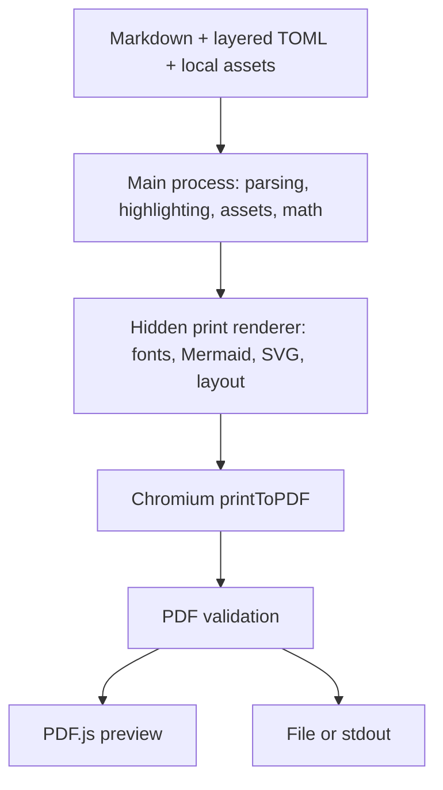

# docm: implementation overview

docm is an offline Markdown-to-PDF application targeting macOS arm64 and Linux x64. Its central decision is **PDF-first preview**: the window displays generated PDF bytes, not a separate HTML approximation. Electron supplies Chromium's layout/printing engine and desktop integration; the tradeoff is a bundled browser runtime and a large application for a small feature set.

## Architecture



[`src/main/index.ts`](src/main/index.ts) coordinates preview, one-shot rendering, native dialogs, and shutdown. `docm notes.md` owns a terminal-attached window; separate invocations are independent. `docm r notes.md [-o report.pdf]` renders once without opening a preview. `-o -` reserves stdout for PDF bytes; diagnostics go to stderr. A desktop launch (Finder, "Open With", or the Linux `.desktop` entry) previews the opened document, or shows a Markdown picker when there is none, and discovers themes in that document's directory. macOS delivers Finder documents as `open-file` events: the first one before launch becomes the instance's document and later ones start separate processes, like separate terminal invocations. The Linux entry uses `%f`, so each selected file gets its own instance.

The shell [launcher](bin/docm) resolves its symlinks and `exec`s the bundled app, preserving the invocation directory, arguments, signals, and exit status without needing developer Node on PATH. Commander handles CLI parsing. Exit codes are 0 for success, 1 for rendering/configuration/I/O failure, 2 for invalid arguments, and 130 for Ctrl-C.

## Content preparation

[`src/render/markdown.ts`](src/render/markdown.ts) uses unified/remark to parse CommonMark, GFM tables/tasks/footnotes, and math into an AST, then rehype to serialize generated HTML. AST processing preserves source positions and separates syntax from literal code.

- **Code and structure:** Shiki highlights bundled languages; unknown languages remain escaped, unhighlighted code. Unique heading IDs support links, optional numbering, and a linked contents block. A custom standalone `:::pagebreak` construct respects code/math literals and avoids empty pages from leading/trailing/repeated breaks.
- **Authored HTML and links:** only configured bare formatting-macro tags are interpreted; other raw HTML is escaped rather than executed, and arbitrary document CSS is not exposed. HTTP(S)/mailto links remain links without fetching their targets. Unsupported link schemes lose their target.
- **Local assets:** [`assets.ts`](src/render/assets.ts) reads, validates, and embeds PNG/JPEG/WebP/GIF/SVG images and font files. Image paths belong to the Markdown file; font/logo paths belong to the configuration file declaring them. Remote image URLs are rejected.

### Math and Mermaid

**MathJax replaces a native TeX toolchain.** [`math.ts`](src/render/math.ts) converts mathematical TeX to vector SVG in the main process. MathJax 4.1.3 and all New Computer Modern glyph ranges are bundled: no CDN, native TeX installation, subprocess, or host-font fallback. `$...$` is inline math; standalone `$$` lines delimit display math. SVG baseline measurements preserve inline alignment.

The enabled packages are `base`, `ams`, `mathtools`, `newcommand`, `textmacros`, `boldsymbol`, and `color`. TOML macros specify `args` (0–9) and a TeX `body`, but cannot replace built-ins. Fresh parser state isolates each expression; input is capped at 64 KiB, with bounded expansion and caching. Invalid commands, unsupported glyphs, and malformed expressions produce diagnostics rather than placeholders. Full LaTeX documents, arbitrary packages, file input, shell execution, and `\require` are unsupported; the math font is fixed.

**Mermaid runs in the print renderer**, where fonts and DOM measurements are available. [`mermaid.ts`](src/render/mermaid.ts) recognizes fences labeled exactly `mermaid`, enables strict security, disables HTML labels, and rejects inline configuration directives/frontmatter. TOML is the single configuration path. `[mermaid.charts.N]` overrides diagrams by one-based Mermaid-only order. One dimension scales proportionally; two define a bounding box. Natural-size diagrams only shrink to fit; explicit sizes may enlarge them, within the printable area.

The shared [SVG sanitizer](src/renderer/print/sanitize-svg.ts) checks image/diagram/math SVG before insertion, rejecting active content and external references. Inserted math/diagram IDs are namespaced to avoid collisions.

## Page layout and printing

[`src/render/pdf.ts`](src/render/pdf.ts) serializes print jobs and creates an isolated hidden window for each, with cancellation and a 60-second timeout. The [print renderer](src/renderer/print/main.ts) loads fonts, decodes images, renders diagrams, inserts math, and waits for layout readiness before printing.

- **One pagination engine:** generated CSS `@page` owns physical dimensions, orientation, margins, and repeated decorations. `printToPDF` uses CSS page sizing, backgrounds, zero API margins, and no built-in header/footer templates. Page-margin boxes require Chromium 131+.
- **Fit without stretching:** images and diagrams fit the printable area. Blocks that fit a page are kept together; oversized tables/code/quotes remain splittable.
- **Measured decorations:** [headers/footers](src/renderer/print/page-decoration.ts) have left/center/right slots, wrapping text, and aspect-preserving logos. Tokens are `{{filename}}`, `{{title}}`, `{{page}}`, and `{{pages}}`; quadruple braces escape literal double braces. Overflow reports a required margin adjustment instead of clipping or silently shrinking.
- **Post-print validation:** PDF.js parses the generated bytes and supplies the real page count for another decoration-overflow check. Tagged output and outlines are requested, but PDF/UA compliance is not promised. Prose/code are selectable; vector math is not guaranteed to be copyable/searchable.

## Configuration model

[`src/config/load.ts`](src/config/load.ts) recursively merges defaults → global theme → invocation-directory `theme.toml` → `--config` → document TOML frontmatter. The global theme is `~/Library/Application Support/docm/theme.toml` on macOS and `$XDG_CONFIG_HOME/docm/theme.toml` on Linux, falling back to `~/.config/docm/theme.toml` when XDG_CONFIG_HOME is unset, empty, or relative. Frontmatter uses opening/closing `+++` lines at the start of the document. Automatic files are optional; explicit configs must exist. CLI discovery does not walk parent directories or implicitly search beside the document.

Strict Zod [schemas](src/config/schema.ts) validate every layer before merging, including values later overridden. Unknown keys, invalid units/colors/font aliases, and margins that leave no printable area are errors. Element typography inherits from the final body style; box spacing does not. Chart overrides inherit final global Mermaid settings. Empty decoration slots, `enabled = false`, and `logo = false` explicitly suppress inherited values.

[`src/config/defaults.ts`](src/config/defaults.ts) is the runtime source of defaults; [`defaults.toml`](defaults.toml) is an editable reference, not automatically loaded. Use `--config defaults.toml` or copy it to `theme.toml`. Defaults include A4 portrait, 20 mm margins, Source Sans 3 prose, Source Code Pro code, and New Computer Modern math. Consult the schema for all supported options.

Each heading block, `[headings.h1]` through `[headings.h6]`, supports `text_align` values `left`, `center`, `right`, and `justify`. The reference TOML explicitly sets all six to `left`; themes that omit the setting still inherit body alignment.

### Formatting macros

`<left>...</left>`, `<right>...</right>`, and `<center>...</center>` are available by default, without configuration. They set the corresponding alignment and support the same Markdown content and nesting as custom macros.

Define additional named formatting overrides in any existing TOML source: the global theme, invocation-directory `theme.toml`, `--config`, or document frontmatter. Definitions merge by name through the same layer order; the highest layer defining a setting wins. The built-in macros are ordinary definitions under `[macro.left]`, `[macro.right]`, and `[macro.center]` and can be redefined through those same layers.

```toml
[macro.mymacro]
text_align = "center"

[macro.flushright]
text_align = "right"
```

Use matching HTML-like tags around Markdown:

```markdown
<mymacro>
# Centered heading

This **paragraph**, and other blocks inside the tags, are centered.

<flushright>
This paragraph is right-aligned instead.
</flushright>
</mymacro>
```

Macros support `text_align = "left"`, `"center"`, or `"right"`, `float = "left"`, `"right"`, or `"none"`, and optional `width` / `height`. Each setting is optional, but a merged macro definition must contain at least one. A macro's alignment is the final override for its enclosed content, above body/element settings and document frontmatter, including Markdown table-column alignment. Images, display math, and Mermaid artwork follow the alignment too. The innermost specified alignment wins, and closing it restores the enclosing alignment. Layout-only macros leave the existing element alignment unchanged.

#### Floats and dimensions

```toml
[macro.figure_right]
float = "right"
width = "60mm"
height = "40mm"
```

```markdown
<figure_right>

</figure_right>

This prose wraps along the left side of the figure, then returns to
the full available width after the floated box ends.
```

The same wrapper accepts fenced code or other Markdown blocks. Put the surrounding prose **after** the closing macro tag, outside the floated wrapper.

| Setting | Behavior |
|---|---|
| `float` | `left` or `right` lets following prose wrap beside the wrapper; `none` disables that macro's float, including an inherited configuration-layer value. It does not clear an earlier sibling float. |
| `width` | Sets the wrapper width, capped to its containing width. Floats reserve an additional 12 pt gap toward the prose. Omit it for normal automatic/shrink-to-fit sizing. |
| `height` | Sets the wrapper height, including any space left beneath its content. Omit it for content-driven height. Artwork shrinks to fit the available width/height without changing aspect ratio; existing element padding and spacing consume part of that space. Text/code is not scaled: content that exceeds an explicit height reports an error rather than clipping or overlapping prose. |

Dimensions must be positive lengths in `px`, `pt`, `mm`, `cm`, or `in`; zero, unitless numbers, percentages, and `auto` are not accepted. Dimensions size the wrapper, not the font, and do not enlarge naturally smaller images. Width, height, and float are local to each wrapper rather than inherited by nested macros; each field still merges normally across TOML sources.

Floats that fit a page are kept together. A float taller than the printable page falls back to normal flow so its content can paginate. `:::pagebreak` clears earlier floats before beginning the next page. These layout controls do not introduce a dedicated caption element; ordinary Markdown inside a wrapper remains part of that floated unit.

Names are case-sensitive ASCII letters followed by letters, digits, `_`, or `-`. Only exact bare `<name>` / `</name>` tags are recognized; attributes and self-closing forms are not supported. Put tags on separate lines for multi-block content; `<mymacro>short text</mymacro>` also works. Alignment is block-level: even same-line macro content gets its own aligned line. Tags can be nested, including repeated names, but must close in order within the same Markdown container. Unclosed or mismatched configured tags report source-located errors.

Code and math contents, escaped tags, and unconfigured HTML remain literal. Macro bodies remain Markdown rather than raw HTML, so headings, tables, code fences, math, diagrams, and local assets retain their existing processing. These formatting macros are independent of TeX command definitions under `[math.macros]`.

## Live updates and safe export

[`PreviewSession`](src/main/session.ts) owns Chokidar watchers, dependencies, revisions, cancellation, and export. Changes are debounced by 250 ms; newer revisions abort obsolete work. The watch set includes source, themes, images, fonts, logos, and missing dependency paths needed for recovery. Results carry SHA-256 dependency snapshots and are published only while their revision and snapshot remain current: filesystem notifications alone do not establish freshness.

The [preview](src/renderer/preview/main.ts) retains the last good PDF while replacements render or fail, showing a stale/error diagnostic rather than blanking the document. [PDF.js integration](src/renderer/preview/pdf-preview.ts) supplies continuous pages, text/link layers, zoom/fit controls, lazy rendering with bounded page buffering, and approximate reading-position restoration. Superseded document loads are cancelled and released. PDF.js is pinned to 5.4.394 and configured with `isEvalSupported: false`; the viewer accepts generated bytes, not arbitrary imported PDFs.

**Export saves the latest successful displayed revision**, not a screenshot or a differently configured re-render. After the native dialog, it waits for current rendering, checks dependencies, and rechecks snapshot/revision before committing. Changed inputs trigger fresh work; invalid current input refuses stale export. Cancellation writes nothing.

[`output.ts`](src/main/output.ts) rejects destinations aliasing source/config/assets, including resolved symlinks and existing hard links. Output goes to an exclusively created same-directory temporary file, which is synced/closed and renamed into place. Precommit failures preserve the existing destination and clean up the temporary file. This is atomic replacement, not a filesystem lock against other processes.

## Process boundaries

The main process owns filesystem access, dialogs, and writes. Both renderers disable Node integration and enable context isolation, sandboxing, and web security. Narrow [preload bridges](src/preload) expose only required operations; main-process IPC checks the sending window and main frame, with an additional URL check for preview requests.

The [`docm:` protocol](src/main/protocol.ts) serves allowlisted bundled resources, applies resource policies, denies permissions, and blocks navigation, popups, and webviews. Print documents block network connections; approved external links open through the system, not inside the app. Bundled fonts/viewer resources and embedded assets allow offline rendering. Shutdown aborts work, closes print windows, stops watchers, and releases resources.


## Build and packaging

TypeScript builds through electron-vite: ESM main process, CommonJS preloads, separate preview/print bundles. electron-builder assembles the native app with the bundled runtime, assets, the [launcher](bin/docm), and third-party notices. [`mise.toml`](mise.toml) pins exact Node and pnpm versions; every task is a `pnpm run` script. Cross-compilation is not supported: each platform packages on its own host.

Electron 44 has no package `postinstall` hook, so after a fresh `pnpm install` run `pnpm run bootstrap:electron` before development or packaging.

| Command | Purpose |
|---|---|
| `pnpm run dev` | Development application |
| `pnpm run build`, `pnpm run typecheck`, `pnpm run test` | Compile, check types, run Vitest |
| `pnpm run smoke` | Build and exercise the development Electron CLI/preview |
| `pnpm run package` | Build the host's distributables into `dist/` |
| `pnpm run package:smoke` | Exercise the unpacked package in `dist/` |
| `node scripts/smoke.mjs --executable PATH` | Exercise an installed launcher, such as `/usr/bin/docm` |
| `pnpm run formula -- DIR [--release OWNER/REPO]` | Print the Homebrew formula for the archives in `DIR` |
| `pnpm run release:version -- patch` | Bump `package.json` (`patch`, `minor` or `major`) without committing or tagging |

`pnpm run package` produces:

| Host | Files | Use |
|---|---|---|
| macOS arm64 | `docm-VERSION-darwin-arm64.tar.gz` (`Docm.app`) | Homebrew |
| Linux x64 | `docm-VERSION-linux-x64.tar.gz` | Homebrew, manual installs, AUR-style repackaging |
| Linux x64 | `docm-VERSION-linux-x64.deb` | Debian, Ubuntu and derivatives |
| Linux x64 | `docm-VERSION-linux-x64.rpm` | Fedora, RHEL, openSUSE |

Building the `.rpm` needs `rpmbuild` on the host (`apt-get install rpm`).

**macOS signing** is ad-hoc (`mac.identity = "-"`), without a Developer ID or notarization. Homebrew does not quarantine formula downloads, so the installed app launches without Gatekeeper prompts. [`scripts/after-pack.mjs`](scripts/after-pack.mjs) rewrites Electron's `@loader_path` dylib IDs to `@rpath` before electron-builder signs. Together with the formula's `preserve_rpath`, this stops Homebrew from rewriting install names, which would break the bundle signature. electron-builder skips signing on pull-request builds unless `CSC_FOR_PULL_REQUEST=true`, which CI sets because ad-hoc signing uses no credentials.

**Linux packages** install to `/opt/Docm`. Their [install scripts](packaging/linux) are electron-builder's defaults with one change: `/usr/bin/docm` (via `update-alternatives`) is the CLI launcher, not the bare Electron executable. The scripts also install electron-builder's AppArmor profile for `/opt/Docm/docm` where AppArmor supports it (Ubuntu 24.04+), and fall back to a setuid `chrome-sandbox` only where user namespaces are unavailable. The sandbox is never disabled. Dependencies are declared per format:

- **`.deb`:** Debian package names, with `t64` alternatives for Ubuntu 24.04's renamed libraries.
- **`.rpm`:** shared-library capabilities such as `libgtk-3.so.0()(64bit)` rather than package names, so the same file resolves on Fedora and openSUSE, whose names differ. It disables `/usr/lib/.build-id` links, which otherwise conflict between Electron apps.

The `.desktop` entry associates `text/markdown` and launches `/opt/Docm/docm %f`.

**Rendering needs a display.** Both preview and one-shot rendering use Chromium windows; printing uses a hidden one. On Linux, `docm r` without `DISPLAY` or `WAYLAND_DISPLAY` switches Chromium to its headless Ozone platform. This is **experimental** (CI reports it without failing). If it fails, use `xvfb-run -a docm r notes.md -o notes.pdf`.

## Distribution

| Platform | Install |
|---|---|
| macOS arm64 | `brew tap john-marinelli/docm https://github.com/john-marinelli/docm.git` then `brew install --formula john-marinelli/docm/docm` |
| Linux x64, any glibc distro | The same Homebrew commands, plus the host libraries and AppArmor note below |
| Debian / Ubuntu | `sudo apt install ./docm-VERSION-linux-x64.deb` |
| Fedora / RHEL | `sudo dnf install ./docm-VERSION-linux-x64.rpm` |
| openSUSE | `sudo zypper install --allow-unsigned-rpm ./docm-VERSION-linux-x64.rpm` |

The [formula](scripts/formula.mjs) installs the prebuilt archive for the host (`on_macos` / `on_linux`). It builds nothing and needs no Node, pnpm or mise. On macOS it links `Docm.app/Contents/Resources/bin/docm`. On Linux it links `libexec/resources/bin/docm` and writes `share/applications/docm.desktop`. If the desktop does not search Linuxbrew's share directory, add `$(brew --prefix)/share` to `XDG_DATA_DIRS`.

Linux targets x86_64 glibc distributions; ARM64 and musl (Alpine) are unsupported. CI verifies Ubuntu 24.04 (`.deb`, Homebrew) and that the `.rpm` installs on current Fedora and openSUSE Tumbleweed. Older glibc releases are untested. Homebrew users install the Electron libraries from their distribution. On Ubuntu 24.04:

```sh
sudo apt-get install libgtk-3-0t64 libnss3 libasound2t64 libgbm1 libdrm2 libatk-bridge2.0-0t64 libx11-xcb1 libxcomposite1 libxdamage1 libxfixes3 libxrandr2 xdg-utils
```

Ubuntu 24.04+ restricts unprivileged user namespaces, which Chromium's sandbox needs. The `.deb` installs a profile automatically; a Linuxbrew installation needs one from an administrator. For the standard prefix (adjust for a custom one), save this as `/etc/apparmor.d/docm-homebrew` and load it with `sudo apparmor_parser -r /etc/apparmor.d/docm-homebrew`:

```text
abi <abi/4.0>,
include <tunables/global>
profile docm-homebrew /home/linuxbrew/.linuxbrew/Cellar/docm/*/libexec/docm flags=(unconfined) {
  userns,
}
```

Do not disable AppArmor globally, run as root, or use `--no-sandbox`. CI loads the equivalent [`scripts/ci-apparmor.profile`](scripts/ci-apparmor.profile).

## Continuous integration and releases

Everything lives in `john-marinelli/docm`: source, workflows, GitHub Release assets, and the tap's `Formula/docm.rb`.

- [CI](.github/workflows/ci.yml) runs on macOS ARM64 and Ubuntu 24.04 x64. On both it type-checks, tests, packages, and installs the archive through a throwaway Homebrew tap ([`scripts/brew-check.sh`](scripts/brew-check.sh)), then checks the installed CLI. On macOS the check also confirms Homebrew left the signature intact. The full smoke runs against `dist/` on macOS and against the installed `.deb` on Linux, where CI also installs the `.rpm` in Fedora and openSUSE containers. Linux uses Xvfb.
- [Release](.github/workflows/release.yml) runs for a pushed `vX.Y.Z` tag. The tag must equal `v` + `package.json`'s version and be on `main`. Each platform repeats the CI checks on the tagged commit. A publish job then uploads every archive and package, with `SHA256SUMS`, to a new GitHub release. It renders the formula with release URLs and opens a **Homebrew: docm X.Y.Z** PR. The tap changes only when that PR is merged. Re-running publish for an existing release fails rather than overwriting it.

One-time setup: the repository and its releases must be public, and **Settings → Actions → General → Workflow permissions → Allow GitHub Actions to create and approve pull requests** must be enabled. PRs opened with `GITHUB_TOKEN` do not trigger CI on their own; the formula PR is checked by the release run that produced it.

To release:

```sh
git switch main && git pull --ff-only
pnpm run release:version -- patch      # or minor / major
git commit -am "chore: release $(node -p 'require("./package.json").version')"
git push origin main
# after CI passes:
git tag "v$(node -p 'require("./package.json").version')"
git push origin "v$(node -p 'require("./package.json").version')"
```

When the workflow finishes, review and merge the formula PR. If published assets are wrong, fix the code and cut a new patch release; published releases are never replaced.
