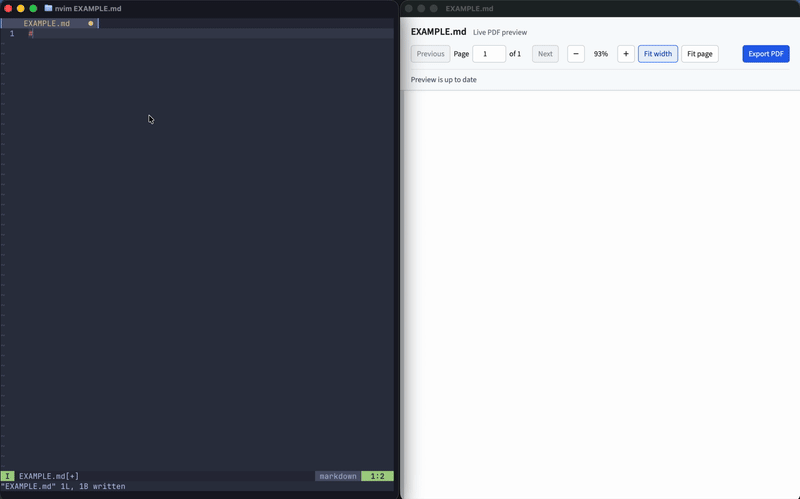

# docm: Document Maker

>This project was created at level 7 of [this (great) framework](https://www.visidata.org/blog/2026/ai/#self-assessed-ai-level-for-contributions) for
self-assessing AI involvment in software. A detailed specification
was provided, but the implementation was left up to an agent.
The LLM-generated readme is at [LLM_README.md](./LLM_README.md),
this one is entirely written by me.



This is docm, a simple program that can live render a markdown
file just like it will be viewed as a pdf, then export it.

I wanted this for myself because if I'm going to be typing, I enjoy
doing it in neovim. I also tried out a few different setups for
writing markdown then rendering to a pdf, but I found any combination
of: previewing wasn't representative of the final product, configuration
was hard to manage, latex wasn't supported, mermaid wasn't supported,
etc. Not saying there isn't anything out there though, just thought
I'd take a crack at making something.

That's why docm now exists, and I think it fixes a lot, if not all, of
the issues I've encountered. The configuration is done through TOML,
with defaults being what I consider sane and plain. The theme.toml
file you have in the directory where you launch docm will override whatever
defaults you put in there, and you an also add TOML frontmatter to a
markdown file to override things.

It's built using Electron, but I'm not super concerned with performance
or bundle size, so I'm fine with it for now. It is large for what it does,
though. Originally I wanted to support arbitrary latex, but that ballooned
the size of things an insane amount, so I switched things to use mathjax,
which has so far been more than enough.

## Usage

### Live preview

`docm <filepath>.md`

### Render

`docm r <filepath>.md` (outputs to `<filepath>.pdf`)

`docm r <filepath>.md -o <outputpath>.pdf`

### Configure

When running, docm will apply defaults, then override them using:

1. `~/Library/Application Support/docm/theme.toml`
2. The `theme.toml` in the directory you're running from.
3. `--config <theme toml file>`
4. TOML frontmatter in the markdown file

In that order, with frontmatter configuration being applied last.

The `--config` argument can be used either during live preview or
rendering.

## Document formatting outside of toml configuration

There is limited control over how documents are rendered outside 
of a config file or frontmatter, but you can use `:::pagebreak` to force
a page break, and of course $ $ for inline latex, $$ $$ for standalone
latex, code blocks in triple back ticks with syntax highlighting, and
mermaid blocks in triple backticks with `mermaid`

## Configuration options

### Lengths and sizes

Lengths and sizes use quoted numbers along with a unit, much like css.
Accepted units are `px`, `pt`, `mm`, `cm` or `in`. You can also use
`0` or `"0"` without the unit.

### Fonts

Fonts can be `sans`, `mono` or a declared font under `[font]`. 

### Options

```toml
[page]
size = "A4"                     # A4, A3, A5, Letter, Legal or custom
orientation = "portrait"        # Options are portrait or landscape
width = "210mm"                 # Only applicable in custom size
height = "210mm"                # Only applicable in custom size

[page.margins]
top = "20mm"
bottom = "20mm"
left = "20mm"
right = "20mm"

[document]
toc = false                     # Table of contents
number_headings = false         # Add numbers to headings

[fonts]
example = "fonts/Example.woff2" # Custom font alias

[body]
font = "sans"                   # Font for normal text
font_size = "11pt"
font_weight = 400
font_style = "normal"
text_align = "left"
line_height = 1.5

[headings.h1]                   # Settings for single big heading
font = "sans"
font_size = "24pt"
font_weight = 600
line_height = 1.25
space_before = "14pt"           # Amount of space above heading
space_after = "6pt"             # Amount of space after heading

[headings.h2]                   # Heading settings are shared unless overriden
font_size = "24pt"              # Except for font_size

[paragraph]
space_after = "8pt"             # Controls space between paragraphs

[link]
color = "#FFFFFF"
underline = true

[list]
space_after = "8pt"
indent = "18pt"                 # How much lists are idented

[table]
font_size = "10pt"
padding = "5pt"
border_width = "0.5pt"
border_color = "#FFFFFF"
header_background = "FFFFFF"
stripe_background = "transparent"   # Color for every other row, transparent turns it off

[blockquote]
border_width = "3pt"
padding = "8pt"
background = "#FFFFFF"

[inline_code]
font = "mono"
font_size = "9pt"
background = "#FFFFFF"

[code]
font = "mono"
font_size = "9pt"
line_height = 1.4
padding = "8pt"
background =  "#FFFFFF"
theme = "github-light"          # These can be any bundled Shiki theme name
wrap = true
line_numbers = false

[mermaid]
font_size = "11pt"
space_before = "8pt"
space_after = "8pt"
theme = "neutral"               # Can be default, neutral, dark or forest
width = "120mm"
height = "120mm"

[mermaid.charts.1]              # Override mermaid options for the first chart
width = "200mm"
height = "200mm"

[image]
space_before = "8pt"
space_after = "8pt"
align = "center"                # Can be left, center, right

[footnotes]
font_size = "9pt"

[rule]                          # The horizontal divider ---
border_width = "0.5pt"
border_color = "#FFFFFF"

[math]
font_size = "11pt"
color = "#FFFFFF"
space_before = "8pt"
space_after = "8pt"

[math.macros.RR]                # A custom macro \RR
args = 0
body = '\mathbb{R}'

[header]                        # Header with left, right and center text
enabled = true
left = ""
center = ""
right = ""
font = "sans"
font_size = "9pt"
font_weight = 400
font_style = "normal"
line_height = 1.25
color = "#FFFFFF"

[header.logo]                   # Optional logo in header or footer
path = "assets/logo.svg"
position = "left"               # Can be left, right or center
width = "18mm"
height = "8mm"

[footer]
enabled = true
left = ""
center = "{{page}} / {{pages}}"
right = ""
font = "sans"
font_size = "9pt"
font_weight = 400
font_style = "normal"
line_height = 1.25
color = "#6B7280"
logo = false                    # False if not using a logo
```


The actual defaults can be viewed at [defaults.toml](./defaults.toml).
